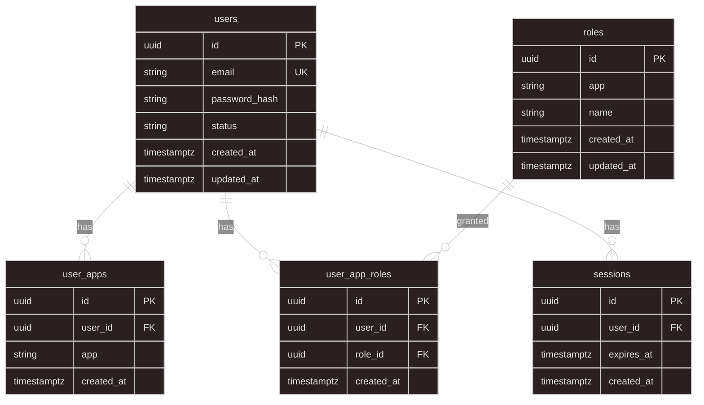

# axum-app

Axum API for the company shop (`/api`) and internal ERP (`/api/internal`), with a shared Google-like identity.

## Identity model (current)

| Table            | Purpose                                               |
| ---------------- | ----------------------------------------------------- |
| `users`          | One account per email                                 |
| `user_apps`      | Which apps the account may open (`shop`, `internal`)  |
| `roles`          | In-app roles (runtime names, e.g. `admin`, `manager`) |
| `user_app_roles` | Role assignments                                      |
| `sessions`       | Server-side session rows (cookie = session `id`)      |

`AppKind` (`shop` \| `internal`) is a Rust enum stored as strings on `user_apps.app` and `roles.app` — same logical values, **not** a separate `apps` table / FK yet.

Tables are defined as SeaORM entities under `src/entity/`. Create them via migrations you run yourself (see project SeaORM rules).

## ERD



### Intended uniqueness (enforce in migrations)

- `users.email` — unique
- `user_apps (user_id, app)` — unique
- `roles (app, name)` — unique
- `user_app_roles (user_id, role_id)` — unique

## Local run

```powershell
# from repo root — requires DATABASE_URL in .env and Postgres tables created
moon run axum-app:dev
```

Default bind: `HOST` / `PORT` (defaults `0.0.0.0:3002`). Health: `GET /health`.
